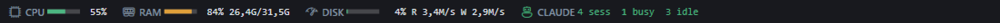
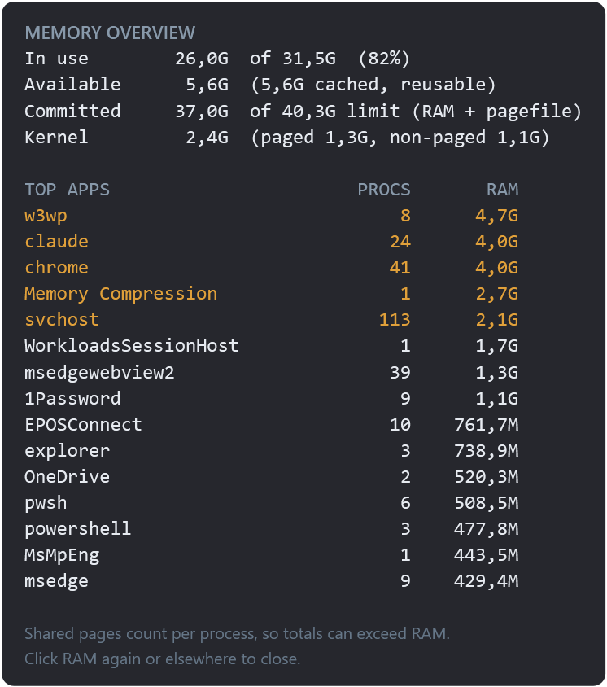
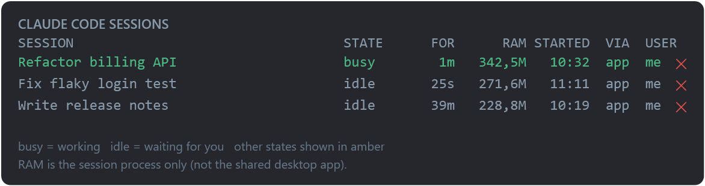

# status-bar

**A status bar for Windows 11.** 
Live CPU, memory, disk and Claude Code sessions, always on top of your screen.

[Why?](#-why) · [Features](#-features) · [Get started](#-get-started-1-minute) · [FAQ](#-faq) · [How it works](#%EF%B8%8F-how-it-works)

---

## 🚗 Why?

You'd never drive a car without a dashboard.

You want to see how fast you're going, how much fuel is left, whether the engine is running hot, and whether that little oil light just came on. You don't stare at the gauges all day. They sit there quietly, and the moment a needle jumps into the red you notice it **before** smoke comes out from under the hood.

I wanted that for my computer. Fans spinning up for no reason? Everything suddenly sluggish? Instead of opening Task Manager and playing detective, I just glance up:

| 🚗 In your car | 💻 On this bar |
|---|---|
| 🏎️ Speedometer | **CPU**: how hard the engine is working |
| ⛽ Fuel gauge | **RAM**: how much room is left in the tank |
| 🌡️ Engine temperature | **DISK**: how busy your drives are right now |
| 🛢️ Oil level | **Drive space**: before it quietly runs dry |
| 🧑‍✈️ Passengers asking "are we there yet?" | **CLAUDE**: which AI sessions are working, and which are waiting for you |

In short: **keep the machine in check while you drive it.** 🏁

> 🤖 **Full honesty:** this whole project was generated by AI (Claude Code) in one conversation. My job was describing what I wanted, testing it, and saying "make it prettier". It took surprisingly little work, which is kind of the point.

---

## ✨ Features

| | |
|---|---|
| 📌 **Docks to the top of your screen** | Windows reserves the space, so maximized windows fit underneath instead of covering it |
| 🧠 **CPU** | Live usage with a mini gauge: 🟢 fine · 🟠 70%+ · 🔴 90%+ |
| 🐏 **RAM** | Used / total memory. **Click** for a breakdown of where it all went |
| 💽 **DISK** | How busy your disks are, plus live read/write speed |
| 🗄️ **Drives** | Free space per drive |
| 🕐 **Clock** | Date and time in the middle, like any good dashboard |
| 🤖 **CLAUDE** | Running Claude Code sessions: busy vs idle. **Click** for details and ✕ to end one |
| 🔔 **"Ready for you"** | A small pop-up and a chime the moment a Claude session finishes its work |
| 🪶 **Lightweight** | One PowerShell script, refreshes every 1.5 s, nothing to install |

### 🐏 Click RAM: "where did my memory go?"

### 🤖 Click CLAUDE: your AI co-pilots at a glance

- **Desktop app and CLI** sessions are both listed, even ones running under a second (admin) Windows account.
- **Real session names** are shown: your `/rename` name or the automatic title.
- **✕ ends a session** after asking you to confirm. If the session belongs to another account, it offers a Windows admin prompt.

---

## 🚀 Get started (1 minute)

1. **Download** this repo: green **Code** button → **Download ZIP**. Unzip it somewhere it can stay, e.g. `%LOCALAPPDATA%\SysBar`.
2. **Double-click `Start-SysBar.bat`.** That's it. Look up. ☝️
3. *(Optional)* **Start it with Windows:** press Win+R, type `shell:startup`, and put a shortcut to `Start-SysBar.bat` in the folder that opens.

**Tips:**
- 🖱️ **Right-click** the bar to switch notifications on/off, show a test notification, or close it.
- 🖥️ **Another monitor:** run `Start-SysBar.bat 1` (or `2`, …) to put the bar on another screen. `0` is your main screen.
- 🪟 **Prefer a small floating window?** `Start-SysWidget.bat` opens a compact, draggable version with the same stats.

---

## ❓ FAQ

<b>Do I need to install anything?</b>

No. It uses Windows PowerShell 5.1 and WPF, which ship with Windows 10 and 11.

<b>Does it slow my computer down?</b>

Barely. It reads a handful of built-in Windows performance values every 1.5 seconds. Session titles are cached and only re-read when they change.

<b>I don't use Claude Code. Does it still work?</b>

Yes. The CLAUDE section just shows 0 sessions. Everything else works the same.

<b>My Windows isn't in English. Will the numbers break?</b>

No. Stats are read from Windows' built-in performance data, which doesn't depend on your language.

<b>How do I get rid of it?</b>

Right-click → **Close SysBar**, then delete the shortcut from `shell:startup` if you added one. Nothing else is left behind, apart from one small file in `%APPDATA%` that remembers where the floating widget sat.

---

## ⚙️ How it works

- **Window:** plain **PowerShell + WPF**, registered with Windows as an *AppBar*, the same mechanism the taskbar uses to claim its strip of the screen.
- **Stats:** read from **WMI performance classes**, which are language-independent.
- **Claude sessions:** each running Claude Code session keeps a small status file in `%USERPROFILE%\.claude\sessions`. The bar reads those for every account it can access. It **never** reads the `.key` files next to them.
- **Self-test:** `SysBar.ps1 -SelfTest` prints the current values without opening the bar.

| File | What it is |
|---|---|
| `SysBar.ps1` | The status bar |
| `Start-SysBar.bat` | Double-click launcher (optional monitor number) |
| `SysWidget.ps1` · `Start-SysWidget.bat` | The floating-widget alternative |

---

## 📄 License

[MIT](LICENSE): use it, change it, share it. Just keep the copyright notice.

---

If this saved you a trip to Task Manager, drop a ⭐. It's the fuel this little dashboard runs on.

